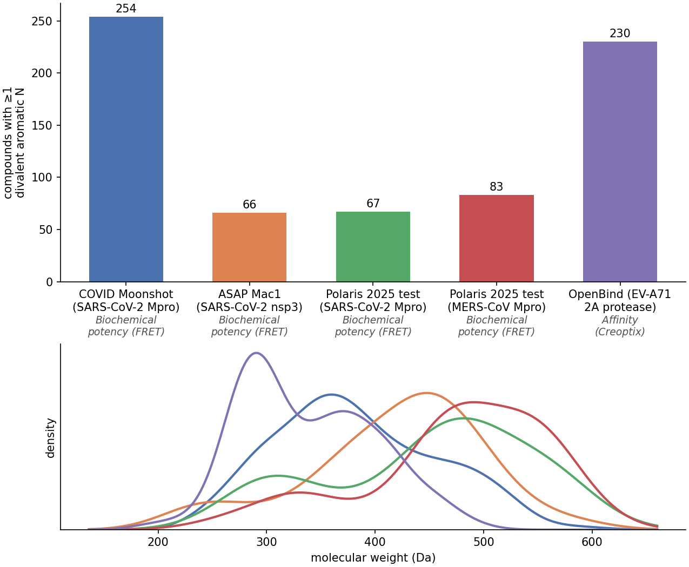

# vsites_datasets

Public protein–ligand datasets for benchmarking whether virtual-site (off-atom charge) strategies are effective. Every compound included has **both** an experimental crystal structure and a measured potency or affinity.

*Top: compounds with ≥1 pyridine-like aromatic N per dataset, with assay type. Bottom: molecular-weight distributions.*

Datasets are defined in `SOURCES` in [`notebook.ipynb`](notebook.ipynb). To build them, create the environment (`mamba env create -f environment.yml`) and run the notebook; data is downloaded to `data/`, which is not tracked.
